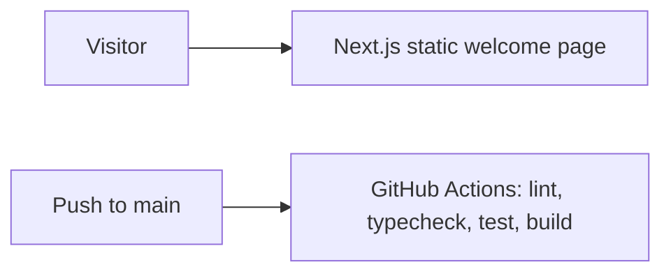

# Architecture

## Implemented foundation

This repository is a pnpm workspace orchestrated by Turborepo. The only application is [@sd/web](apps/web/package.json), a Next.js App Router application. Its [home route](apps/web/app/page.tsx) renders a static [welcome component](apps/web/features/welcome/components/Welcome/Welcome.tsx); the page does not fetch data or call an API. English and Bangla appear together, and the default styling is light.

The [CI workflow](.github/workflows/ci.yml) runs the quality gates on Linux, Windows, and macOS. The [Vercel page](https://sawdagar-dokanpart.vercel.app/) has been checked for its rendered text. A Neon project exists, but the application does not connect to it. The repository does not currently contain an application database schema, authentication service, API, shared domain package, or seed data.

## Planned architecture

The [architecture specification](docs/spec/03-architecture.md) describes the proposed web, API, domain, database, and integration layers. These are design goals, not implemented services. Check free-tier eligibility and record decisions before integrating external providers.

## Limitations

There is no marketplace transaction flow, server-side authorization, localization switcher, or dark theme yet. The current test covers rendered welcome text, not browser interaction, accessibility, or performance.
