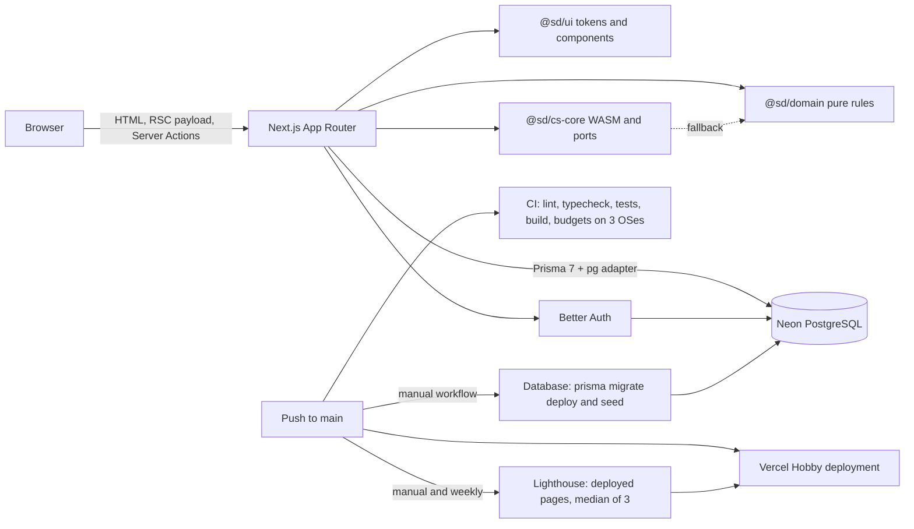

# Architecture

## Overview

Sawdagar Dokanpat is a pnpm workspace orchestrated by Turborepo. A Next.js App Router application serves every page, writes through Server Actions and reads PostgreSQL through Prisma. There is no separate application server and no catalog HTTP API: pages query Prisma directly on the server, and the browser only sends the inputs an action validates.

The deployment is deliberately free-forever: the web app runs on Vercel Hobby, PostgreSQL runs on Neon Free, and CI, migrations and the Lighthouse audit run in GitHub Actions. Payments are sandbox only.

## Workspace

- [@sd/web](apps/web/package.json): the Next.js application. Routes live in [apps/web/app](apps/web/app), feature code in [apps/web/features](apps/web/features), shared server helpers in [apps/web/lib](apps/web/lib), and the Prisma schema, migrations and seed scripts in [apps/web/prisma](apps/web/prisma) and [apps/web/scripts](apps/web/scripts).
- [@sd/ui](packages/ui/package.json): design tokens in [theme.css](packages/ui/src/theme.css), the original brand mark and jamdani pattern, and small components with matching skeleton pairs.
- [@sd/domain](packages/domain/package.json): pure TypeScript rules for money, categories, the deterministic catalog seed, roles and permissions, addresses, coupons, order state, reviews and returns, seller rules and the finance ledger.
- [@sd/cs-core](packages/cs-core/package.json): a C++ relevance ranker and a C SKU kit compiled to freestanding WebAssembly, integer-only TypeScript ports, and Python and Java reference implementations with shared fixtures.

## Request flow

1. The [root layout](apps/web/app/layout.tsx) reads the `sd_theme` and `sd_locale` cookies and the Better Auth session before rendering the shell. Theme and language are server-rendered, so there is no flash or client-side patch.
2. A page is a Server Component. It validates route input, loads data through a feature query file, and passes plain objects to components. Loading states come from a route `loading.tsx` whose skeleton matches the real layout.
3. Interactive pieces are client islands: the shop provider around the cart, wishlist and comparison state, the variant picker, the checkout form and the theme and language controls. They receive server data and call Server Actions; they do not compute prices or totals.
4. Every mutation is a Server Action in a feature folder. It parses input with Zod, resolves the viewer from the session, re-reads the variant, store or order on the server, and returns typed state for the form or controller. Rejected writes roll optimistic client updates back.
5. Reads use Prisma through [getPrisma](apps/web/lib/prisma.ts), which creates the client lazily so a build without `DATABASE_URL` never opens a connection.

## System diagram

## Catalog and search

The listing route validates search parameters with Zod in [catalogQuery.ts](apps/web/features/catalog/catalogQuery.ts); an unknown category, malformed price, rating or page falls back to a safe value instead of throwing. [queries.ts](apps/web/features/catalog/queries.ts) builds one Prisma `where` clause for the category subtree, vendor, price range, rating, stock and text query, counts the matches, clamps the page and returns 12 products.

A text query is ordered by the relevance ranker: [searchEngine.ts](packages/cs-core/src/searchEngine.ts) loads the committed WebAssembly module and falls back to the TypeScript port. The ranker reorders at most 120 matches and never overrides an explicit price or rating sort. The listing shows which engine ordered the page.

The [product route](apps/web/app/product/%5Bslug%5D/page.tsx) loads one active product with its variants, vendor and category, plus four related products and its reviews, questions and rating summary. It returns 404 for unknown or inactive products, emits Product JSON-LD and a self-referencing canonical, and marks the description for search snippets with [metaDescription](apps/web/lib/meta.ts). Dynamic-route metadata is blocking because [next.config.ts](apps/web/next.config.ts) sets `htmlLimitedBots`, so the title and description always arrive in the document head.

Catalog imagery is one licensed department photograph stored under [public/media/departments](apps/web/public/media/departments); [media.ts](apps/web/features/catalog/media.ts) picks the department, a per-product crop and a localised description, and the attribution is published at `/credits`.

## Cart, wishlist, compare and coupons

[getShopState](apps/web/features/shop/queries.ts) runs in the root layout. It resolves the signed-in cart, or the guest cart behind the HTTP-only `sd_cart` cookie, plus wishlist ids and the `sd_compare` cookie, and passes them into [ShopProvider](apps/web/features/shop/components/ShopProvider/ShopProvider.tsx).

Cart writes call [actions.ts](apps/web/features/shop/actions.ts). Each action validates ids and quantity, checks product status and variant stock, and returns the full cart rows; [useCartController](apps/web/features/shop/components/ShopProvider/useCartController.ts) applies them optimistically and rolls back on failure. Guest carts live in `carts` with a random token, expire 30 days after the last write, and are merged into the user cart by [cartMutations.ts](apps/web/features/shop/cartMutations.ts) on sign-in.

- Wishlist rows are per user in `wishlist_items`, capped at 100; guests are prompted to sign in.
- Comparison is cookie-only (`sd_compare`, at most four ids) because it must work before sign-in.
- A coupon is evaluated on the server with integer poisha by [coupons.ts](packages/domain/src/shop/coupons.ts) before it is saved on the cart, and re-evaluated on every visit; an expired, under-minimum or wrong-vendor code is dropped.
- Drawer totals in [cartTotals.ts](apps/web/features/shop/cartTotals.ts) are an estimate with a flat delivery fee below the free-delivery threshold. Checkout charges shipping per seller and destination zone.

## Checkout, payments and orders

[CheckoutView](apps/web/features/checkout/components/CheckoutView/CheckoutView.tsx) collects a saved or new address, a payment method and a note. The address data in [bangladesh.ts](packages/domain/src/checkout/bangladesh.ts) covers all 64 districts in eight divisions. The browser sends no price, product total or shipping amount.

[orderPlacement.ts](apps/web/features/checkout/orderPlacement.ts) re-reads the cart, evaluates the coupon, allocates the discount across lines in integer poisha, computes shipping per seller for the Dhaka, outside-Dhaka and remote zones, and writes the order in one transaction. Stock is decremented with a conditional update that matches only while `stock >= quantity`; a miss rolls the whole order back. Orders split into one `sub_orders` row per seller, with an immutable shipping snapshot on the order.

- Cash on delivery confirms the order immediately and leaves the payment pending until collection.
- MockPay creates a `pending_payment` order, holds stock in `stock_reservations` for 30 minutes and returns a signed payment link from [mockPayToken.ts](apps/web/features/checkout/mockPayToken.ts). The callback route confirms the payment, order and sub-orders and converts held stock; a repeated callback returns `alreadyPaid`.
- The confirmation is written to `mail_outbox` in the same transaction, so the demo needs no mail provider. The receipt, printable invoice and in-app outbox are at `/orders/[number]`, `/orders/[number]/invoice` and `/account/mail`.
- There is no scheduled job that releases an abandoned reservation yet; the limitation is recorded in [PROJECT_STATE](docs/PROJECT_STATE.md).

## Reviews, questions and returns

Ownership and timing are enforced in the actions, with the rules shared in [reviewRules.ts](packages/domain/src/reviews/reviewRules.ts). A review requires the session user's delivered order line and no earlier review; a return additionally requires delivery inside seven days.

A review stores a rating, headline and body, and up to three browser-resized JPEG data URLs in `review_photos` because no object storage is configured. Only reviews with an `orderItemId` show the verified-purchase badge. The product's rating and review count are recomputed from published rows inside the same transaction as the insert. Admin moderation can hide a review and recomputes the aggregate again.

Questions are public once asked, rate-limited to five per user per hour, and answered by a member of the product's store. Returns are one per delivered line, with a reason, note and status; the seller decides and finance performs the refund.

## Seller Center and store approval

Every store carries `status` and `kycStatus`. A product may be saved as a draft at any time, but only an approved store with approved KYC can activate one; [sellerRules.ts](packages/domain/src/seller/sellerRules.ts) holds `canSell`. KYC in this demo is a text submission: legal name, business type, trade licence, payout phone and district.

The Seller Center at [apps/web/app/seller](apps/web/app/seller) is guarded by [session.ts](apps/web/features/seller/session.ts) and limited to store owners for writes. It provides:

- dashboard counts, revenue and recent sub-orders;
- product create, edit and archive, with bilingual fields, category, price and tone;
- variant price and stock edits, plus append-only `inventory_adjustments` rows in the same transaction;
- sub-order fulfillment through confirmed, packed, shipped (courier and tracking required) and delivered; cancelling before dispatch restores stock;
- answers to questions, return decisions, store-scoped coupons and ninety-day analytics with a CSV export;
- storefront settings for name, bilingual announcement, about and policies, and the public page at `/store/[slug]`.

## Finance and the double-entry ledger

Money is integer poisha. `@sd/domain` builds balanced transactions in [ledger.ts](packages/domain/src/finance/ledger.ts) and [ledgerService.ts](apps/web/features/finance/ledgerService.ts) posts them inside the caller's transaction.

- A delivery debits `platform:cash`, credits the store payable with goods minus commission plus shipping, and credits commission revenue. Commission is taken from discounted goods only, in basis points (`organizations.commissionRateBps`, 800 by default, 700 for every fourth seeded store).
- A payout is requested by an owner for at least ৳1,000 and no more than the available balance. Approval and payment are separate states; paying debits the store payable and credits cash.
- Refunding an approved return writes one `refunds` row and a `refund` transaction that debits the store payable and commission revenue and credits cash. The return becomes `refunded`; no gateway refund is sent.
- `(kind, referenceId)` is unique, so a retried delivery, payout or refund is a no-op. Balances are always derived from entries; there is no stored total to repair. A negative payable after a refund is carried forward, not clamped.

## Admin, CMS, flags and audit

[guard.ts](apps/web/features/admin/guard.ts) checks the platform role, and [nav.ts](apps/web/features/admin/nav.ts) filters the admin navigation to the areas a role can use. The admin surface covers store approvals with the KYC record, review moderation, content, flags, platform analytics, finance and an audit viewer.

Content lives in `cms_entries` for three kinds: static page, Help article and Journal post. Each save appends an immutable `cms_versions` snapshot; restoring an old version writes a new version rather than rewriting history. Status is draft, scheduled or published, and the public queries only return published entries whose publish time has passed. Bodies are plain text with paragraphs split on blank lines, so authored content cannot inject markup.

Feature flags gate the Help Center and Journal, fall back to seeded defaults when the table is empty, and keep the storefront building without a database. Privileged actions append to `audit_logs`.

## CS core

[packages/cs-core](packages/cs-core) exists to show the algorithms, not to hide them behind a library.

| Module | Written in | Runs in the product as | Used by |
|---|---|---|---|
| search-core | C++ to WebAssembly (2.7 KB) | the compiled module, TypeScript port as fallback | catalog search ordering |
| sku-kit | C to WebAssembly (1.1 KB) | the compiled module, TypeScript port as fallback | product SKUs and their check character |
| insights | Python reference | TypeScript port | seller demand column |
| settlement | Java reference | TypeScript port | admin payout preview |

`/cs-lab` runs every module and reports the active engine. CI runs the Python and Java references with `--require`, so a missing runtime fails the build. [CS_FUNDAMENTALS.md](docs/CS_FUNDAMENTALS.md) explains each algorithm and its complexity.

## Data and migrations

The schema has 38 tables across authentication, catalog, carts, checkout, reviews, Seller Center, finance and content; [DATABASE.md](docs/DATABASE.md) lists each table, its relation and its indexes. Nine SQL migrations under [apps/web/prisma/migrations](apps/web/prisma/migrations) build it.

Migrations and seeds never run from a developer machine or during a Vercel build. The manual [Database workflow](.github/workflows/db.yml) takes `migrate`, `seed` or `status`, holds `DIRECT_DATABASE_URL`, and serialises runs. The runtime uses the pooled `DATABASE_URL`.

The seed is deterministic and idempotent: 12 departments, 72 leaf categories, 24 vendors, 432 products, 1,296 variants, 1,755 published reviews, three demo orders, 11 CMS entries and two flags. Re-running it restores them without duplicating rows.

## Deployment and CI

- Vercel Hobby deploys `main`. The build does not connect to the database; every data route is dynamic and reports a missing configuration at request time.
- [CI](.github/workflows/ci.yml) runs lint (format check plus ESLint), typecheck, tests, a production build, the client asset-budget check and generated-file drift checks on Ubuntu, Windows and macOS, plus a fourth job that runs the Python and Java reference modules.
- [Database](.github/workflows/db.yml) applies migrations and seeds.
- [Lighthouse](.github/workflows/lighthouse.yml) audits the deployed home, catalog and product pages on demand and weekly, with three mobile runs per URL and assertions of 90 for each category and 0.1 for layout shift.
- Environment variables are `DATABASE_URL`, `DIRECT_DATABASE_URL`, `BETTER_AUTH_SECRET` and `DEMO_ACCOUNT_PASSWORD`; [DEPLOYMENT.md](docs/DEPLOYMENT.md) records where each one lives.

## Testing

170 unit tests cover the domain rules (money, seed invariants, roles, coupons, order state, reviews and returns, seller rules, ledger balance), the WebAssembly and TypeScript parity of every CS fixture, shared UI rendering, catalog filter parsing, cart totals, comparison limits, CMS validation, admin navigation, localized place names and the committed `llms.txt` copy.

There is no browser or visual-regression suite. axe-core and the six-width responsive review were run by hand against the deployment in Phase 11; Lighthouse is the only performance and accessibility check that runs in CI. [TESTING.md](docs/TESTING.md) records the exact runs and scores.

## Limitations

- Catalog search is a bounded substring match with relevance ordering, not full-text search: no stemming, transliteration or autocomplete, and vendor names are not searched from the box.
- Products share one representative department photograph; there is no per-product gallery or zoom.
- MockPay reservations expire after 30 minutes, but no scheduled job releases abandoned ones. SSLCommerz sandbox and Stripe test mode are not wired.
- Payouts are marked paid by finance; there is no bKash, Nagad or bank API and no settlement file. Refunds are ledger entries, not gateway refunds.
- Review photos are data URLs in PostgreSQL. There is no object storage or media library.
- Finance balances are summed in JavaScript from every entry. This is fine at demo volume but should become a SQL aggregate as transactions grow.
- The CMS edits plain text without rich text, embedded images or a block layout. Feature flags cover only the Help Center and Journal.
- Staff members can read the Seller Center but cannot write; KYC has no document uploads and there is no new-store application flow.
- Bulk CSV import, packing-slip PDFs and seller replies to reviews are not implemented. CSV export is.
