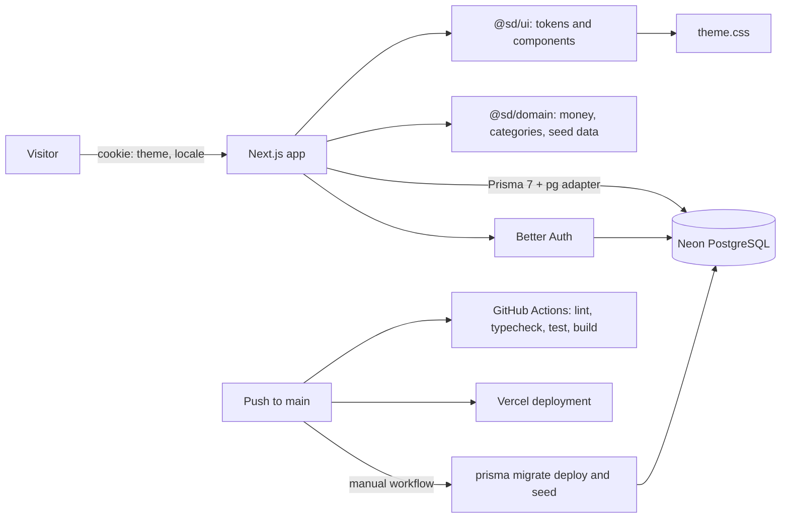

# Architecture

## Implemented

This repository is a pnpm workspace orchestrated by Turborepo with three packages:

- [@sd/web](apps/web/package.json): Next.js App Router application. The [root layout](apps/web/app/layout.tsx) reads the theme and language cookies and renders the shell around each route. Routes: the [home page](apps/web/app/page.tsx), [catalog listing](apps/web/app/catalog/page.tsx), [product page](apps/web/app/product/%5Bslug%5D/page.tsx), [design gallery](apps/web/app/design/page.tsx), auth pages and the role-guarded account, seller and admin areas.
- [@sd/ui](packages/ui/package.json): design tokens in [theme.css](packages/ui/src/theme.css), an original brand mark and pattern, and small components with skeleton pairs.
- [@sd/domain](packages/domain/package.json): pure helpers for taka formatting, the category tree, catalog seed generation, roles, permissions and demo accounts.

Both themes share one set of custom properties; `[data-theme='dark']` overrides them on the document root, and the gallery repeats the attribute on a nested section to show the two themes side by side. The server reads `sd_theme` and `sd_locale` before rendering, so there is no theme flash and no client-side language patch. Preference forms are Server Actions that only set those cookies.

## Catalog flow

1. The listing route validates the URL with Zod in [catalogQuery.ts](../apps/web/features/catalog/catalogQuery.ts). Bad slugs, prices, ratings, sorts and pages fall back to safe values rather than throwing.
2. [queries.ts](../apps/web/features/catalog/queries.ts) builds a Prisma `where` clause with `status: 'active'`, the chosen category subtree, vendor, price range, rating and stock. Search adds a bounded `OR` over English and Bangla titles and category names.
3. One query returns the page of products with their vendor; a second returns the filtered count. Page size is 12. Both run on the server, so no price or filter is trusted from the client.
4. The product route loads one product by slug with its variants, vendor and leaf category, then fetches four related active products from the same category. It returns 404 for unknown or inactive products.
5. Listing and detail pages render shared cards, price and rating components. The variant picker is the only client component on the product page; it selects among server-provided options and does not calculate prices.
6. There is no catalog API route yet. Pages query Prisma directly; a later phase can add route handlers for cart and checkout without changing the schema.

The category tree is two levels deep: departments (`depth: 0`) contain leaf categories (`depth: 1`). A catalog request for a department includes all of its leaves. A request for a vendor shows that store's products without a category restriction.

## Seeding

[buildCatalogSeed](../packages/domain/src/catalog/catalogSeed.ts) expands curated inputs in [catalogSeedData.ts](../packages/domain/src/catalog/catalogSeedData.ts) deterministically: 12 departments x 6 leaves x 3 styles x 2 colours gives 6 products per leaf, 432 products in total. FNV-1a hashes set stock, ratings, review counts and creation dates, so every run produces identical values. The seed script upserts categories, vendors and products, and replaces variants and tags for each product.

The [CI workflow](.github/workflows/ci.yml) runs on Linux, Windows and macOS. The [Vercel project](https://sawdagar-dokanpart.vercel.app/) deploys `main`. Migrations and seeds run only through the manual [Database workflow](.github/workflows/db.yml), which holds the direct Neon connection.

## Planned

The [architecture specification](docs/spec/03-architecture.md) describes the API, cart, order, finance and integration layers. Those are design goals; check free-tier eligibility and record decisions before integrating providers. Phase 4 adds a persistent cart; later phases add seller catalog editing, orders and finance.

## Limitations

- The marketplace transaction flow, seller catalog editing, order management and finance do not exist yet.
- There is no browser, end-to-end or visual-regression suite. The gallery frames are fixed-width previews, not automated responsive tests.
- Media is an SVG pattern because no photography or media host is integrated.
- Search is SQL `ILIKE` over a small catalog, not a full-text index. Vendor names are intentionally excluded from the search box; use the vendor link on a product page.
