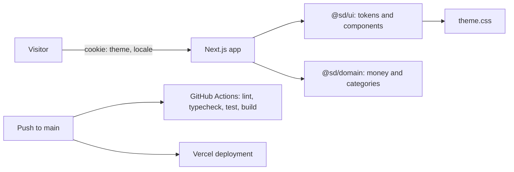

# Architecture

## Implemented

This repository is a pnpm workspace orchestrated by Turborepo with three packages:

- [@sd/web](apps/web/package.json): Next.js App Router application. The [root layout](apps/web/app/layout.tsx) reads the theme and language cookies and renders the shell around each route. Routes: the [home page](apps/web/app/page.tsx) and the [design gallery](apps/web/app/design/page.tsx).
- [@sd/ui](packages/ui/package.json): design tokens in [theme.css](packages/ui/src/theme.css), an original brand mark and pattern, and small components with skeleton pairs.
- [@sd/domain](packages/domain/package.json): pure helpers for taka formatting and the top-level category list.

Both themes share one set of custom properties; `[data-theme='dark']` overrides them on the document root, and the gallery repeats the attribute on a nested section to show the two themes side by side. The server reads `sd_theme` and `sd_locale` before rendering, so there is no theme flash and no client-side language patch. Preference forms are Server Actions that only set those cookies; no user data is stored.

The [CI workflow](.github/workflows/ci.yml) runs on Linux, Windows and macOS. The [Vercel project](https://sawdagar-dokanpart.vercel.app/) deploys `main`. There is no database connection, API, authentication or seeded catalog yet.

## Planned

The [architecture specification](docs/spec/03-architecture.md) describes the API, database, authentication and integration layers. Those are design goals; check free-tier eligibility and record decisions before integrating providers.

## Limitations

The marketplace transaction flow, server-side authorization, catalog data and browser test suite do not exist yet. The gallery frames are fixed-width previews, not automated responsive tests. Media is an SVG pattern because no photography or media host is integrated.
