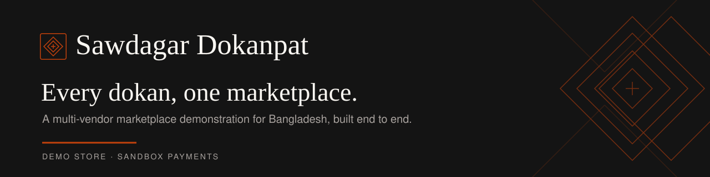
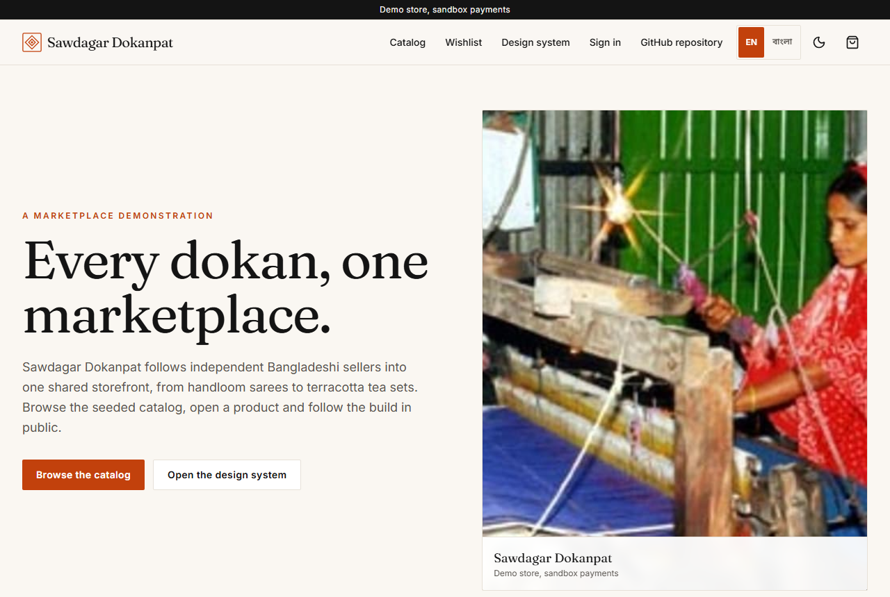
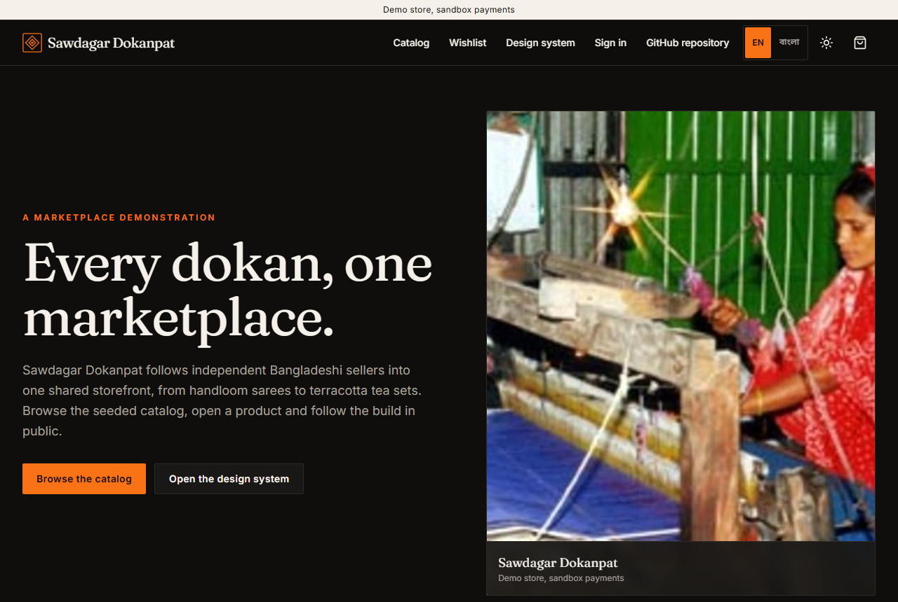
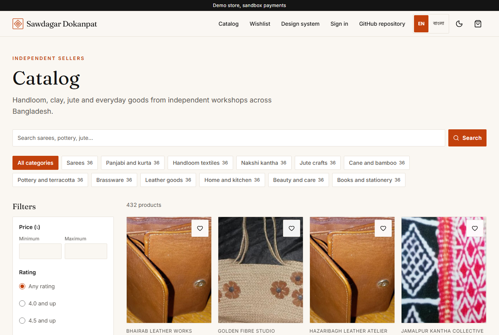
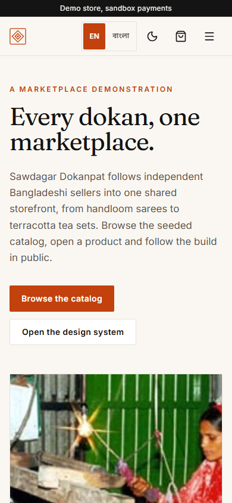
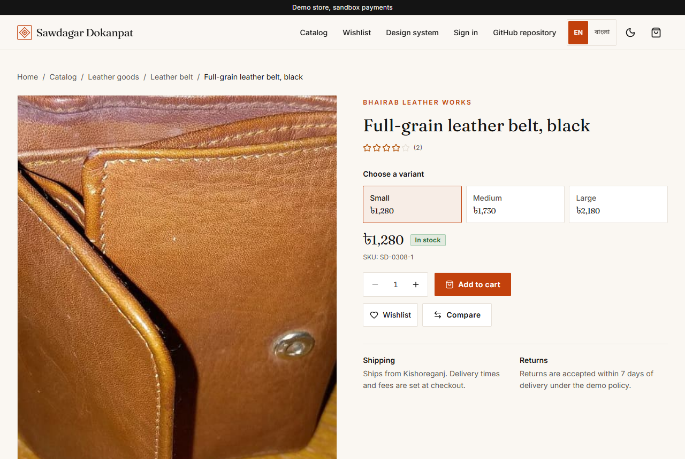
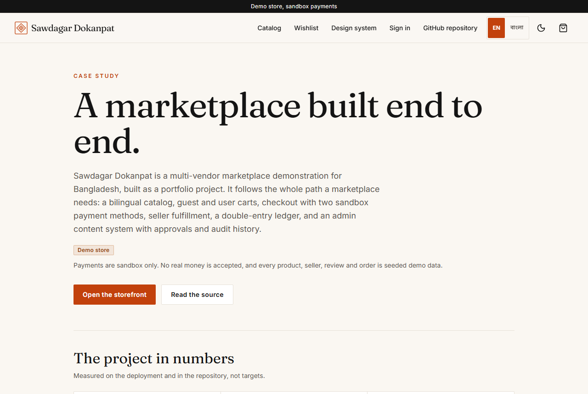
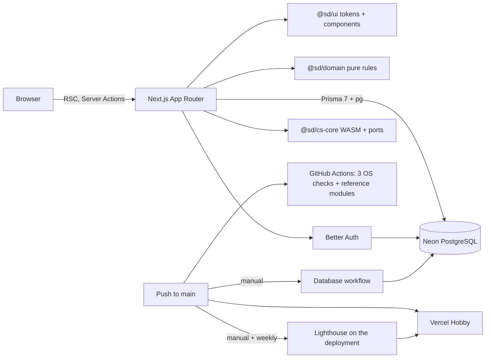
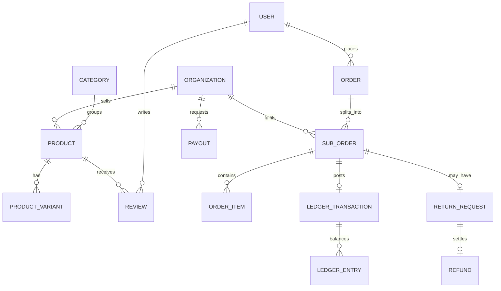

[](https://github.com/ibrahimSumon47/sawdagar-dokanpart/actions/workflows/ci.yml)
[](https://github.com/ibrahimSumon47/sawdagar-dokanpart/actions/workflows/lighthouse.yml)


Sawdagar Dokanpat is a bilingual, multi-vendor marketplace demonstration for Bangladesh: a catalog of 432 products from 24 fictional workshops, with carts, checkout, seller fulfillment, a double-entry ledger and an admin CMS.

**[Open the demo](https://sawdagar-dokanpart.vercel.app/)** · [Case study](https://sawdagar-dokanpart.vercel.app/case-study) · [Architecture](ARCHITECTURE.md) · [Feature index](docs/FEATURES.md)

> **Demo store: sandbox payments.** This is a portfolio project, not a shop. No real money is accepted, no order is fulfilled, and every product, seller, review and order is seeded demo data. Payments are cash on delivery or the MockPay sandbox only.

## Screenshots

 

 

 

## Demo accounts

Use a **Try demo** button on the [sign-in page](https://sawdagar-dokanpart.vercel.app/sign-in); no password is shown or needed.

| Role | Demo email |
|---|---|
| Buyer | `buyer@demo.sawdagar.test` |
| Vendor owner | `vendor@demo.sawdagar.test` |
| Vendor staff | `staff@demo.sawdagar.test` |
| Support agent | `support@demo.sawdagar.test` |
| Moderator | `moderator@demo.sawdagar.test` |
| Finance admin | `finance@demo.sawdagar.test` |
| Content editor | `editor@demo.sawdagar.test` |
| Super admin | `admin@demo.sawdagar.test` |

Demo accounts cannot change their email or password. The allowlist lives in [`packages/domain/src/auth/demoAccounts.ts`](packages/domain/src/auth/demoAccounts.ts).

## Why this project exists

Most portfolio storefronts stop at a product grid and a cart. The interesting part of a marketplace is what happens after the button: two sellers in one order, stock that cannot be sold twice, a payment callback that can arrive again, commission that has to balance, a return that moves money backwards, and a seller who needs to run a shop without calling the platform.

This repository follows that path to the end, keeps every service free and replaceable, and writes the decisions down. It is also a study in honest scope: sandbox payments, seeded data, and a known-limitations list rather than a pretence that this is production infrastructure.

## What you can do

**As a buyer**

- Browse 12 departments, 84 categories and 432 products in English or Bangla; search, filter by category, vendor, price, rating and stock, and sort.
- Choose a variant, add to a guest or signed-in cart, save a wishlist, compare four products, and apply a coupon.
- Check out with a saved or new address across 64 districts, choose COD or MockPay, and see per-seller shipping.
- Print an invoice, review a delivered product with photos, ask a question, and request a return inside seven days.
- Read the Help Center and Journal, run the CS modules at `/cs-lab`, and inspect the design system at `/design`.

**As a vendor owner**

- Submit store and KYC details, and keep products in draft until both are approved.
- Create and edit bilingual products, variants, prices and stock, with an append-only inventory history.
- Confirm, pack, ship with courier and tracking, and deliver sub-orders; cancel before dispatch to restore stock.
- Answer questions, decide returns, create store coupons, read ninety-day analytics with a CSV export, and manage the public store page.

**As platform staff**

- Approve stores and moderate reviews; hiding a review recomputes the product rating.
- Read cash, commission and seller payable balances; approve, pay or reject payouts; refund approved returns.
- Edit Storefront, Help and Journal content with drafts, scheduled publishing, preview and version history.
- Switch feature flags, view platform analytics, and read a paginated audit log.

The full role matrix is in [`docs/SECURITY.md`](docs/SECURITY.md), and every feature is mapped to its files in [`docs/FEATURES.md`](docs/FEATURES.md).

## Tech stack

| Layer | Choice | Why |
|---|---|---|
| Framework | Next.js 16.4.3 App Router, React 19.3.1 | Server Components keep prices and stock on the server; Server Actions remove a hand-written API layer. |
| Language | TypeScript 5.9.3, strict | Shared types across the app and pure domain packages; no `any` in application code. |
| Data | PostgreSQL 18 on Neon Free, Prisma 7.10.1 with `@prisma/adapter-pg` | Relational data with transactions and conditional stock updates; Neon's free plan needs no card and scales to zero. |
| Auth | Better Auth 1.7.14 | Self-hosted sessions with rate limits and no vendor lock-in. |
| UI | Tailwind CSS 4.3.3, tokens in `@sd/ui` | One palette drives both themes; container queries let a card grid follow its own width. |
| Validation | Zod 4.6.7 | The same schemas guard Server Actions and form inputs. |
| Tests | Vitest 5.0.5 | Fast unit tests for pure rules and a small WebAssembly parity suite. |
| Monorepo | pnpm 12.15.0, Turborepo 2.11.10, Node 24 | Shared packages with cached lint, typecheck, test and build tasks. |
| Audit | `@lhci/cli` 0.15.1 | Lighthouse runs against the deployment in GitHub Actions, with median-of-three mobile runs. |
| Hosting | Vercel Hobby, GitHub Actions, Neon Free | Every service is free forever and needs no credit card. |

Versions and licences are pinned in [`docs/TECH_VERSIONS.md`](docs/TECH_VERSIONS.md); the free-tier checks are in [`ADR-001`](docs/adr/ADR-001-free-services.md).

## CS fundamentals

Four small modules sit behind the storefront, each written twice: once in the language that shows the idea, and once in the implementation the site runs. None of them is a wrapper around a library.

| Module | Language | Concept | Used by | Code |
|---|---|---|---|---|
| search-core | C++ → WebAssembly | Byte tokenization, weighted token scoring, optimal string alignment with a one-edit cap, coverage, integer scores | Catalog search ordering, with a TypeScript fallback | [`search_core.cpp`](packages/cs-core/native/search_core.cpp) |
| sku-kit | C → WebAssembly | State-machine normalization, validation, position-weighted check character | New product SKUs | [`sku_kit.c`](packages/cs-core/native/sku_kit.c) |
| insights | Python reference | Integer velocity, trend in basis points, days of cover, restock quantity | Seller demand column via the TypeScript port | [`insights.py`](packages/cs-core/python/insights.py) |
| settlement | Java reference | Whole-taka payout rounding with carried poisha and a minimum | Admin payout preview via the TypeScript port | [`Settlement.java`](packages/cs-core/java/Settlement.java) |

The compiled modules are 2.7 KB and 1.1 KB, freestanding and committed as base64 so install, test and deploy never need a compiler. CI runs the Python and Java references with `--require`. [`docs/CS_FUNDAMENTALS.md`](docs/CS_FUNDAMENTALS.md) explains each algorithm and its complexity; `/cs-lab` runs them in the browser.

## Architecture



There is no separate API server: pages read through Prisma on the server, and every write is a Server Action that validates input, resolves the viewer from the session, and re-reads the product, stock or order before it changes anything. Prices, totals, roles and owner ids are never accepted from the browser.



The schema has 38 models across authentication, catalog, carts, checkout, reviews, Seller Center, finance and content. [`docs/DATABASE.md`](docs/DATABASE.md) lists every table and index; [`ARCHITECTURE.md`](ARCHITECTURE.md) follows each flow from route to transaction.

## Repository structure

```text
apps/web                 Next.js routes, feature code, Prisma schema, migrations and seeds
  app/                   Storefront, account, seller, admin, content, CS lab and case study
  features/              One folder per capability: catalog, shop, checkout, reviews, seller, finance, admin, content, showcase
  prisma/                Schema, nine SQL migrations and seed scripts
  scripts/               Idempotent demo, catalog, order, review and coupon seeds
packages/ui              Design tokens, brand mark, shared components and skeleton pairs
packages/domain          Money, categories, seed rules, roles, coupons, orders, reviews, seller and ledger rules
packages/cs-core         C++/C WebAssembly modules, Python and Java references, TypeScript ports, fixtures
docs/                    Product, design, architecture, data, security, testing, deployment and ADRs
```

## Engineering challenges

**Stock integrity.** Two buyers can pass a stock check at the same moment. Checkout decrements stock with a conditional update that only matches while `stock >= quantity`, inside the same transaction as the order line; a miss rolls back the whole order. MockPay holds a 30-minute reservation so the unit is not offered again while the buyer is on the sandbox gateway.

**A callback that arrives twice.** The MockPay link carries a signed, expiring token, and the payment row moves through explicit states with a conditional update. A repeated callback finds the finished state and returns without writing.

**A ledger that explains itself.** Money is integer poisha. Each delivery, payout and refund writes a `ledger_transactions` row whose debits equal its credits; `(kind, referenceId)` is unique, so a retry is a no-op, and balances are sums of entries, not stored columns. Commission comes from discounted goods only and shipping passes to the seller.

**A deterministic seed.** Twelve departments expand through fixed rules and an FNV-1a hash into the same catalog on every run. Upserts let the seed follow any migration without duplicating rows, and it runs only through the manual Database workflow.

**No layout shift.** A product card and its skeleton import the same aspect ratio and spacing from one constants file; the grid and its skeleton share the same container-query classes. Layout shift measured 0 on all three Lighthouse routes.

**Metadata where crawlers look.** Next.js streamed dynamic product metadata after the shell, leaving the title and description in the body. Setting `htmlLimitedBots` makes metadata blocking, canonicals are declared per route, and descriptions are shortened to snippet length at a word boundary.

## Performance and tests

Lighthouse CI, median of three mobile runs on the deployed site (run [41067055369](https://github.com/ibrahimSumon47/sawdagar-dokanpart/actions/runs/41067055369)):

| Route | Performance | Accessibility | Best practices | SEO | LCP | TBT | CLS |
|---|---:|---:|---:|---:|---:|---:|---:|
| Home | 93 | 100 | 100 | 100 | 3.06 s | 124 ms | 0 |
| Catalog | 95 | 100 | 100 | 100 | 2.78 s | 71 ms | 0 |
| Product | 93 | 100 | 100 | 100 | 3.19 s | 68 ms | 0 |

The build ships 249.1 KiB of gzipped client JavaScript, 9.8 KiB of gzipped CSS and a 71.8 KiB largest chunk; the twelve catalog photographs total 852 KiB, with a 144.8 KiB largest file. Budgets are checked after every build.

There are 170 unit tests:

| Package | Tests | Focus |
|---|---:|---|
| `@sd/domain` | 73 | Money, seed invariants, roles, coupons, order state, reviews and returns, seller rules, ledger balance |
| `@sd/cs-core` | 15 | WebAssembly and TypeScript parity for every fixture, including Bangla search |
| `@sd/ui` | 17 | Rendering, skeleton parity, token contrast in both themes |
| `@sd/web` | 65 | Filters, cart totals, comparison limits, CMS validation, admin navigation, localized places, metadata snippets, `llms.txt` |

axe-core 4.10.2 reported zero violations on nine template, theme and width combinations in the Phase 11 review; that review was manual. [`docs/TESTING.md`](docs/TESTING.md) records every check and its limits.

## CI/CD

| Workflow | Trigger | What it does |
|---|---|---|
| [`CI`](.github/workflows/ci.yml) | Every push to `main` | Lint, typecheck, 170 tests, production build, asset budgets and generated-file drift checks on Ubuntu, Windows and macOS; a fourth job runs the Python and Java references with `--require` |
| [`Database`](.github/workflows/db.yml) | Manual | `migrate`, `seed` or `status` against the direct Neon connection, serialised by a concurrency group |
| [`Lighthouse`](.github/workflows/lighthouse.yml) | Manual and weekly | Three mobile runs per URL against the deployment; fails below 90 in any category or above 0.1 CLS |

A Vercel deployment of `main` follows a green build. The Vercel build never touches the database: every data route is dynamic and reports a missing configuration at request time.

## Deploy your own

[](https://vercel.com/new/clone?repository-url=https://github.com/ibrahimSumon47/sawdagar-dokanpart)

Create a free Neon project, then set these variables in Vercel and in the GitHub repository (Actions secrets):

| Variable | Where | Purpose |
|---|---|---|
| `DATABASE_URL` | Vercel, GitHub | Pooled Neon connection used by the app |
| `DIRECT_DATABASE_URL` | GitHub only | Direct connection used by migrations and seeding |
| `BETTER_AUTH_SECRET` | Vercel, GitHub | Signs and verifies sessions; use a long random value |
| `DEMO_ACCOUNT_PASSWORD` | Vercel, GitHub | Password for the eight seeded demo accounts |

After the first deploy, run the **Database** workflow with `migrate`, then `seed`. The app serves static routes without a database, but catalog, cart and account pages need one. Node 24 is required. Never commit any of these values; [`docs/DEPLOYMENT.md`](docs/DEPLOYMENT.md) lists the owner actions.

## Known limitations

- Payments are sandbox only: cash on delivery and MockPay. SSLCommerz sandbox and Stripe test mode need owner accounts and are not wired.
- MockPay reservations expire after 30 minutes, but no scheduled job releases abandoned ones yet.
- Refunds are ledger entries and a refund row; no gateway refund is sent. Payouts are marked paid by finance; there is no bKash, Nagad or bank API.
- Catalog products share one licensed representative photograph per department, not a photograph of each item. There is no gallery or zoom.
- Review photos are bounded data URLs in PostgreSQL because no object-storage host is configured.
- Search matches English and Bangla titles and leaf-category names, ranks at most 120 matches, and has no stemming, transliteration or autocomplete.
- Staff can read the Seller Center but cannot write; KYC is a text submission with no document uploads, and there is no new-store application flow.
- Bulk CSV import, packing-slip PDFs and seller replies to reviews are not implemented; CSV export is.
- The CMS edits plain text without rich text or embedded images. Feature flags cover only the Help Center and Journal.
- Finance balances are summed in JavaScript from every ledger entry, which is fine at demo volume but should become a SQL aggregate.
- There is no automated browser or visual-regression suite. axe and the six-width review were manual; Lighthouse is the only browser check that runs in CI.
- Seeded reviews belong to synthetic buyers without login accounts. The storefront labels the whole site as demo data.

The complete list, including the reasoning behind each omission, is in [`docs/PROJECT_STATE.md`](docs/PROJECT_STATE.md#known-issues).

## Roadmap

| Phase | Scope | Status |
|---|---|---|
| 0–1 | Foundation, design system, shell, themes, i18n | Done |
| 2–3 | Auth, roles, catalog, search, product pages | Done |
| 4–5 | Cart, wishlist, compare, coupons, checkout, orders, invoices | Done |
| 6–7 | Reviews, questions, returns, Seller Center, store CMS | Done |
| 8–9 | Ledger, payouts, refunds, admin, CMS, flags, analytics, audit | Done |
| 10 | C++/C WebAssembly, Python and Java references, `/cs-lab` | Done |
| 11 | Photography, localization, accessibility, six-width review, Lighthouse | Done |
| 12 | README, case study, ADRs, `llms.txt`, project facts, repository map | Done |

Next candidates, recorded honestly rather than promised: a released-reservation job, a concurrency test for the last unit of stock, a richer search index, and staff permission sets.

## Skills demonstrated

- Server-rendered React with a strict boundary between server data and client interaction.
- Relational modelling, transactions, conditional updates and idempotency in PostgreSQL.
- A double-entry ledger with commission, payouts and refunds, tested as pure functions.
- C++ and C compiled to freestanding WebAssembly, with parity-tested TypeScript ports.
- Design tokens, light and dark themes, container-query layout and skeleton parity.
- Accessibility work measured with axe and Lighthouse, and honest reporting of what was manual.
- Cross-platform CI, manual database migrations, and performance budgets against a real deployment.
- Documentation that a reviewer can navigate: feature index, ADRs, project state, lessons and a machine-readable summary.

## AI-readable repository

- [`llms.txt`](llms.txt) and [`/llms.txt`](https://sawdagar-dokanpart.vercel.app/llms.txt): the project summary for assistants and crawlers.
- [`docs/PROJECT_FACTS.json`](docs/PROJECT_FACTS.json): name, stack, test counts, seed volumes, demo accounts and links.
- [`docs/repo-map.md`](docs/repo-map.md): folder tree with one-line purposes.
- [`docs/adr/`](docs/adr): ten architecture decision records.

## License

[MIT](LICENSE). The catalog photographs have their own licences and attribution; see [docs/CREDITS.md](docs/CREDITS.md).
