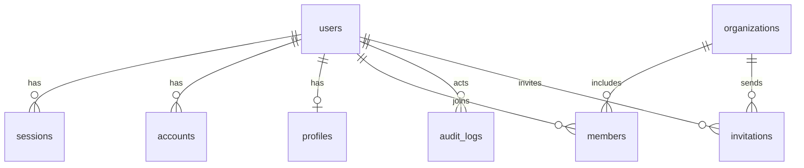

# Database

## Current status

The `sawdagar-dokanpat` project in a Neon Free organization (`aws-us-east-1`, PostgreSQL 18) holds the Phase 2 authentication schema. The initial migration was applied through the [Database workflow](../.github/workflows/db.yml) on 2026-10-28, followed by the demo seed. Connection strings live only in the Vercel and GitHub dashboards; the application uses the pooled Neon URL, while Prisma CLI commands use the direct URL.

Schema source: [schema.prisma](../apps/web/prisma/schema.prisma). Migration: [20261028090000_init](../apps/web/prisma/migrations/20261028090000_init/migration.sql). Prisma 7 requires a driver adapter, so the app builds a client from `@prisma/adapter-pg` with `pg`; the generated client is not committed and is produced by `prisma generate`.

## Tables

| Table | Purpose |
|---|---|
| `users` | Better Auth identity plus platform `role`, ban fields and `isDemo` |
| `sessions` | Session token, expiry, client details, active organization and impersonation |
| `accounts` | Credential and future OAuth accounts, unique by provider and account id |
| `verifications` | Better Auth verification tokens and expiry |
| `organizations` | Vendor stores, unique by slug |
| `members` | Store membership with owner or staff role, unique per user and store |
| `invitations` | Pending store invitations and expiry |
| `rate_limits` | Database-backed Better Auth request counters |
| `profiles` | Bangladeshi phone, district and short bio for an account |
| `audit_logs` | Append-only record of demo sign-ins, profile changes and future privileged actions |

## Operations and budget

- Migrations and seeding run only through the `Database` workflow (`workflow_dispatch` with `migrate`, `seed` or `status`); never locally.
- `DIRECT_DATABASE_URL` is used by the Prisma CLI; `DATABASE_URL` is the pooled runtime connection.
- No images or files are stored in PostgreSQL.
- Database size, query plans and index measurements have not been recorded yet; add them when catalog data lands, and keep the free storage budget in view.
- The seed is idempotent: it creates missing demo users, refreshes roles, and upserts profiles, the store and memberships.
