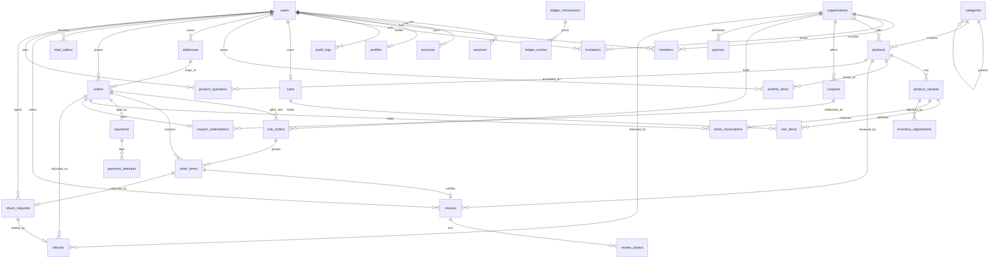

# Database

## Current status

The `sawdagar-dokanpat` project in a Neon Free organization (`aws-us-east-1`, PostgreSQL 18) holds the authentication, catalog and cart schemas. The initial migration was applied through the [Database workflow](../.github/workflows/db.yml) on 2026-10-28, followed by the catalog migration and two seed runs. Connection strings live only in the Vercel and GitHub dashboards; the application uses the pooled Neon URL, while Prisma CLI commands use the direct URL.

Schema source: [schema.prisma](../apps/web/prisma/schema.prisma). Migrations: [20261028090000_init](../apps/web/prisma/migrations/20261028090000_init/migration.sql), [20261028140000_catalog](../apps/web/prisma/migrations/20261028140000_catalog/migration.sql), [20261028170000_cart_wishlist](../apps/web/prisma/migrations/20261028170000_cart_wishlist/migration.sql), [20261028190000_coupons](../apps/web/prisma/migrations/20261028190000_coupons/migration.sql), [20261028200000_checkout_orders](../apps/web/prisma/migrations/20261028200000_checkout_orders/migration.sql), [20261028220000_reviews_returns](../apps/web/prisma/migrations/20261028220000_reviews_returns/migration.sql) and [20261028220000_seller_center](../apps/web/prisma/migrations/20261028220000_seller_center/migration.sql). All seven are applied to Neon through the `Database` workflow on 2026-10-28; the checkout migration ran in run 40684155525, and the review/returns and seller-center migrations and seeds in the following runs. Prisma 7 requires a driver adapter, so the app builds a client from `@prisma/adapter-pg` with `pg`; the generated client is not committed and is produced by `prisma generate`.

## Tables

| Table | Purpose |
|---|---|
| `users` | Better Auth identity plus platform `role`, ban fields and `isDemo` |
| `sessions` | Session token, expiry, client details, active organization and impersonation |
| `accounts` | Credential and future OAuth accounts, unique by provider and account id |
| `verifications` | Better Auth verification tokens and expiry |
| `organizations` | Vendor stores, unique by slug, with approval and KYC state, legal business details, the bilingual storefront CMS fields and a commission rate in basis points |
| `members` | Store membership with owner or staff role, unique per user and store |
| `invitations` | Pending store invitations and expiry |
| `rate_limits` | Database-backed Better Auth request counters |
| `profiles` | Bangladeshi phone, district and short bio for an account |
| `audit_logs` | Append-only record of demo sign-ins, profile changes and future privileged actions |
| `categories` | Two-level catalog tree: `depth` 0 is one of 12 departments, `depth` 1 is a leaf with 6 seeded products |
| `products` | Localised title and description, display price, compare-at price, total stock, rating and review count, seller store and leaf category |
| `product_variants` | Ordered options for one product, each with its own SKU, price, compare-at price and stock; one is the default |
| `inventory_adjustments` | Append-only stock change per variant: actor, signed delta, reason (`restock`, `correction`, `damage`, `return`), optional note, resulting stock and time |
| `carts` | One cart per signed-in user or one per guest token; `expiresAt` is 30 days after the last write and `couponCode` holds one applied code. A check constraint requires exactly one owner |
| `cart_items` | Variant, quantity and timestamps, unique per cart and variant |
| `wishlist_items` | Saved product per user, unique per user and product |
| `coupons` | Code, type (`percent`, `fixed`, `free_shipping`), basis-points or poisha value, global or vendor scope, minimum subtotal, optional cap, start and end time, and active flag |
| `addresses` | Saved delivery address per user: recipient, Bangladeshi phone, division, district, upazila, optional area and street line, with one default |
| `orders` | One buyer order with number, status, payment state and method, money totals, coupon code, an immutable shipping snapshot and an optional link to the saved address |
| `sub_orders` | One seller's part of an order, with its own number, status, money totals, confirmed/packed/shipped/delivered/cancelled timestamps, courier and tracking number |
| `order_items` | Product, variant, localised title and variant name, SKU, unit price, quantity and line total captured at purchase time |
| `reviews` | One rating, headline, body and status per order line; seeded historical reviews have no `orderItemId`, so only UI-written reviews carry the verified-purchase badge |
| `review_photos` | Up to three resized JPEG data URLs per review, ordered by `sortOrder` |
| `product_questions` | Buyer question, optional seller answer with timestamp and answering user |
| `return_requests` | One request per delivered order line: reason, note, status and optional resolution note |
| `payments` | Provider (`cod` or `mockpay`), status, amount, unique provider reference and failure code |
| `payment_attempts` | Append-only attempts for one payment, including the demo gateway's initiated, paid and failed events |
| `stock_reservations` | Ordered quantity per variant, held for MockPay or confirmed for COD, with an expiry for future cleanup |
| `coupon_redemptions` | Coupon, order, user and the goods-plus-shipping discount recorded once per order |
| `mail_outbox` | In-app copy of a transactional message, with recipient, subject, body and read state |
| `ledger_transactions` | One balanced money movement, unique by kind (`delivery`, `payout`, `refund`) and the row it settles, with an optional memo |
| `ledger_entries` | Debit or credit line in poisha against an account code such as `platform:cash` or `seller:<id>:payable` |
| `payouts` | A store's withdrawal request: number, amount, requested and processing users, status and note |
| `refunds` | One paid refund per approved return request, with the amount, the reversed commission and the order link |

## Catalog shape

- Seed data is original content in [catalogSeedData.ts](../packages/domain/src/catalog/catalogSeedData.ts), expanded deterministically by [catalogSeed.ts](../packages/domain/src/catalog/catalogSeed.ts). It creates 12 departments, 72 leaf categories, 24 vendors, 432 active products and 1,296 variants (three per product).
- A leaf category holds exactly 6 products: 3 styles x 2 colours. Every vendor sells in one department, across its six leaf categories, for 18 products per vendor.
- `products.priceMinor` is the lowest default variant price and `products.totalStock` is the sum of variant stock, so listing filters can run on one table without joins. The seed keeps both in sync; a future seller editor must update them in the same transaction as variants.
- Prices are integer poisha in Bangladeshi taka. They are never floats and never sent from the client.
- `products.rating` and `reviewCount` are aggregates of published rows in `reviews`, not independent display counters. The seed writes the historical reviews first and then sets each product from their average and count; a buyer review recomputes both inside its transaction. The old formula that produced 6 to 150 synthetic review counts is gone.
- Search matches the English and Bangla product title and the English and Bangla leaf-category name. Descriptions are not searched yet; a future search phase can add a text index without changing the UI.
- No product photos exist. `products.tone` picks one of the original SVG pattern tones until a media phase adds a URL and an image host.

## Cart and wishlist shape

- A signed-in cart is found by `userId`; a guest cart is found by the random UUID stored in the HTTP-only `sd_cart` cookie. The cookie is `SameSite=Lax`, `Secure` in production and lasts 30 days.
- `createGuestCart` reuses a live cart, deletes an expired one and issues a new token. Every write extends `expiresAt`.
- On demo sign-in, `mergeGuestCartIntoUser` folds each guest row into the user cart, caps the quantity at current stock, deletes the guest cart and clears the cookie.
- Removing a cart row still works if the product has since become inactive, so a buyer can always clear a stale line. Adding and quantity changes check `status = 'active'` and stock first.
- Wishlist rows are DB-only and require a signed-in user. Guests get a sign-in prompt instead of a local-only list. The cap is 100 products.
- Comparison is deliberately cookie-only (`sd_compare`, JSON array, max four ids) because it is a short-lived, non-sensitive browsing aid and must work before sign-in. Removing a stale product is allowed; adding checks that the product is active.
- No cleanup job deletes expired carts yet. They are ignored after expiry and will need a scheduled delete when the demo has real traffic.
- A coupon is evaluated on the server with integer poisha before it is saved on the cart. The cart re-evaluates the saved rule on every visit and silently drops it if it expired, no longer meets its minimum, or no longer matches a vendor-scoped cart. Four seeded codes cover the three coupon types: `BOISHAKH10`, `DHAKA200`, `FREESHIP` and vendor-scoped `TANGAIL15`.

## Reviews, questions and returns

- Ownership and timing are both enforced on the server. A review requires the order line to belong to the session user, its sub-order to be `delivered`, and no existing review; a return additionally needs `deliveredAt` inside the seven-day window. `isReviewable` and `isReturnable` in `@sd/domain` hold the rules and are unit-tested.
- Reviews carry the verified-purchase badge only when `orderItemId` is set. Seeded reviews are written by synthetic buyer rows with no login account, so they never claim a purchase.
- `review_photos.dataUrl` keeps a browser-resized JPEG (maximum 960 px, under 220,000 characters) with the row. There is no object-storage host on the free plan yet; the cap keeps the request inside the Server Action body limit. Moving to R2 later means adding a URL column and one upload step, not changing the review model.
- A question is public once asked and can be answered only by a store member; the answer fields are on the question row for the Seller Center, which arrives in Phase 7. Questions are rate-limited to five per user per hour.
- Product rating and review count are recomputed with a single aggregate query inside the same transaction as the review insert, so a failed photo write cannot leave the card showing a rating that has no row.

## Seller Center shape

- Every store row carries `status` (`pending`, `approved`, `rejected`, `suspended`) and `kycStatus` (`not_started`, `pending`, `approved`, `rejected`). A product can be saved as a draft at any time, but `active` is rejected unless both are approved; `canSell` in `@sd/domain` holds the rule and is unit-tested.
- KYC is a text submission in this demo: legal name, business type, trade licence number, payout phone and district, with submit and review timestamps. There are no document uploads yet, so the model does not pretend to store identity files. `docs/PROJECT_STATE.md` records the limitation.
- The storefront CMS lives on `organizations`: name, bilingual announcement, about, return policy and shipping policy, an accent and a cover tone. The public page reads only approved stores and active products.
- Stock changes by the seller write an `inventory_adjustments` row inside the same transaction as the variant update, and the product's cached `totalStock` is recomputed from the variants afterwards. Manual changes are bounded to 1,000 units per action by `applyInventoryAdjustment`.
- A sub-order carries its own timestamps for confirmed, packed, shipped, delivered and cancelled. Shipping requires a courier and tracking number in the action and input schema. Cancelling before dispatch restores each line's stock and records a `return` adjustment; after delivery, a return request takes over.
- The store's `orders.total` is not rewritten during fulfillment. The order becomes `completed` only when every sub-order is delivered, and `cancelled` when every sub-order is cancelled.
- A store coupon is still a `coupons` row with `scope = 'vendor'` and `organizationId`; promotion history and redemptions are preserved when a seller deactivates it.

## Finance shape

- Money is double-entry. Every `ledger_transactions` row has `ledger_entries` whose debits equal credits, and the account codes are stable strings rather than a second table. `@sd/domain` holds the entry builders, `commissionFor`, `sellerNetFor`, `signedBalance` and `availableForPayout`, and their unit tests assert that every transaction balances.
- Commission is taken from goods after discount, never from shipping; the seller receives the goods minus commission plus the shipping fee. `organizations.commissionRateBps` defaults to 800 (8%) and the seed gives every fourth store 700 (7%) to exercise a negotiated rate.
- Delivering a sub-order posts one `delivery` transaction: cash is debited, the store's payable is credited with total minus commission, and commission revenue is credited. The unique `(kind, referenceId)` pair makes a repeated delivery a no-op instead of a double payment.
- A payout is requested only by an owner, needs at least ৳1,000 and cannot exceed the payable balance minus payouts already in flight. Approval, payment and rejection are separate states; paying it posts the `payout` transaction and settles the store's payable in cash.
- Refunding an approved return creates one `refunds` row, marks the return `refunded` and posts a `refund` transaction that debits the store's payable and the commission revenue and credits cash. A store can end up owing the platform after a refund of an already-paid order; the negative payable is carried forward rather than clamped.
- Ledger balances are never edited or deleted. Corrections are new transactions, and the finance pages derive every number from entries, payouts and refunds rather than stored totals.

## Checkout and order shape

- The checkout migration adds `addresses`, `orders`, `sub_orders`, `order_items`, `payments`, `payment_attempts`, `stock_reservations`, `coupon_redemptions` and `mail_outbox`. Its SQL was generated with `prisma migrate diff` from the coupon schema so the hand-written models and migration agree.
- The browser sends only an address choice or address fields, a payment method and a note. The server re-reads the cart, evaluates the coupon, computes shipping per seller and recalculates VAT before writing anything.
- Stock is decremented with `UPDATE ... WHERE stock >= quantity` inside the same transaction as the order. If either the variant or the product summary update matches no row, the whole transaction rolls back with a stock failure. Two buyers cannot both take the last unit.
- A COD order is confirmed immediately and its payment stays pending until the courier collects. A MockPay order starts as `pending_payment`; the signed callback marks the payment paid, confirms the order and the seller sub-orders, and converts held reservations to confirmed. Repeating the callback finds no pending payment row and returns `alreadyPaid`.
- The address snapshot on `orders` is written even when a saved address is later edited or deleted. `addressId` is only a convenience link.
- The confirmation message is written to `mail_outbox` in the same transaction. No mail provider is required, so the order flow stays inspectable on the free plan.

## Indexes

| Index | Query it serves |
|---|---|
| `products(category_id, status)` | Category listing and category counts |
| `products(organization_id)` | Vendor listing and vendor product counts |
| `products(status, created_at)` | Newest-first listing |
| `products(price_minor)` | Price range filters |
| `products(rating)` | Minimum-rating filter |
| `product_variants(product_id)` | Loading the variants of one product |
| `product_variants(sku)` unique | Stock keeping units |
| `categories(parent_id)` and `categories(sort_order)` | Category navigation |
| `carts(user_id)` unique and `carts(guest_token)` unique | Finding the signed-in or guest cart |
| `carts(expires_at)` | Future expired-cart cleanup |
| `cart_items(cart_id, variant_id)` unique | One row per variant in a cart |
| `cart_items(variant_id)` | Variant stock and cart lookups |
| `wishlist_items(user_id, product_id)` unique | Toggle idempotency and the wishlist page |
| `wishlist_items(product_id)` | Product deletion checks |
| `coupons(code)` unique | Coupon lookup at apply time |
| `coupons(organization_id)` | Vendor-scoped coupon checks |
| `coupons(active, ends_at)` | Active coupon filtering |
| `addresses(user_id, created_at)` | Checkout address book |
| `orders(number)` unique | Order receipt lookup |
| `orders(user_id, placed_at)` | A buyer's recent orders |
| `orders(status, placed_at)` | Operational order queues |
| `sub_orders(order_id)` and `sub_orders(organization_id, status)` | Order detail and seller queues |
| `order_items(variant_id)` | Stock and sales lookups |
| `payments(provider_ref)` unique | Idempotent gateway callback lookup |
| `payments(order_id, status)` | Order payment summary |
| `stock_reservations(variant_id, status)` | Held stock by variant |
| `stock_reservations(expires_at, status)` | Future reservation cleanup |
| `coupon_redemptions(order_id)` unique | One coupon record per order |
| `mail_outbox(user_id, created_at)` | The buyer's outbox |
| `reviews(product_id, status, created_at)` | Published reviews for a product, newest first |
| `reviews(user_id, created_at)` | A buyer's own reviews |
| `reviews(order_item_id)` unique | One review per delivered line |
| `review_photos(review_id)` | Photos for one review |
| `product_questions(product_id, created_at)` | Recent questions on a product |
| `product_questions(user_id, created_at)` | A buyer's questions and the hourly limit |
| `return_requests(order_item_id)` unique | One open request per line |
| `return_requests(user_id, created_at)` and `return_requests(status, created_at)` | Buyer history and the seller queue |
| `inventory_adjustments(variant_id, created_at)` | A variant's stock history, newest first |
| `ledger_transactions(kind, reference_id)` unique | Idempotent delivery, payout and refund posting |
| `ledger_transactions(created_at)` | Newest transactions for the finance audit view |
| `ledger_entries(transaction_id)` | Entries of one balanced transaction |
| `ledger_entries(account_code, created_at)` | An account's running balance |
| `payouts(number)` unique | Payout reference lookup |
| `payouts(organization_id, requested_at)` and `payouts(status, requested_at)` | A store's history and the platform queue |
| `refunds(return_request_id)` unique | One refund per return request |
| `refunds(organization_id, created_at)` and `refunds(status, created_at)` | Store and platform refund history |

Search uses `ILIKE '%term%'` over 432 products, which is acceptable at this size. A trigram index or PostgreSQL full-text search is a later optimisation; the query is capped at 80 characters and the page size is fixed.

## Operations and budget

- Migrations and seeding run only through the `Database` workflow (`workflow_dispatch` with `migrate`, `seed` or `status`); never locally.
- `DIRECT_DATABASE_URL` is used by the Prisma CLI; `DATABASE_URL` is the pooled runtime connection.
- No uploaded media library exists. The only image bytes in PostgreSQL are the bounded review thumbnails described above.
- The seeded catalog fits comfortably in the Neon Free storage and compute budget. No database size or query-plan measurement has been recorded yet; add one if the catalog grows or a page becomes slow.
- The seed is idempotent. It upserts users, profiles, categories, vendors and products, replaces a product's variants, and never duplicates rows. Re-running it restores the same 432-product catalog, store approvals and CMS copy, 1,755 seeded reviews and three demo orders (two delivered for the buyer account and one confirmed for the demo store), and recomputes product ratings from all published review rows. Because it is a demo reset, it also restores the seeded stock and product fields, so seller edits are intentionally replaced on the next seed run.
