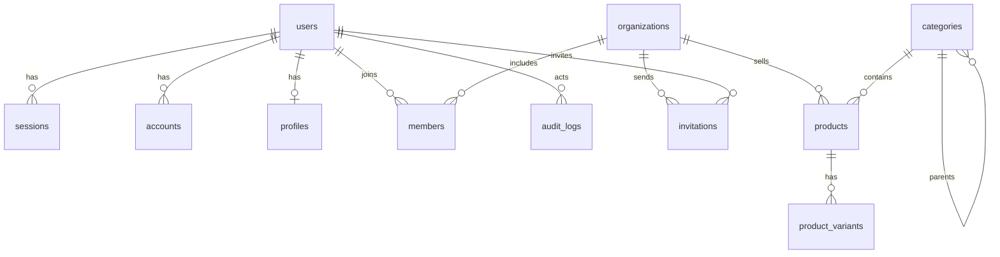

# Database

## Current status

The `sawdagar-dokanpat` project in a Neon Free organization (`aws-us-east-1`, PostgreSQL 18) holds the authentication and catalog schemas. The initial migration was applied through the [Database workflow](../.github/workflows/db.yml) on 2026-10-28, followed by the catalog migration and two seed runs. Connection strings live only in the Vercel and GitHub dashboards; the application uses the pooled Neon URL, while Prisma CLI commands use the direct URL.

Schema source: [schema.prisma](../apps/web/prisma/schema.prisma). Migrations: [20261028090000_init](../apps/web/prisma/migrations/20261028090000_init/migration.sql) and [20261028140000_catalog](../apps/web/prisma/migrations/20261028140000_catalog/migration.sql). Prisma 7 requires a driver adapter, so the app builds a client from `@prisma/adapter-pg` with `pg`; the generated client is not committed and is produced by `prisma generate`.

## Tables

| Table | Purpose |
|---|---|
| `users` | Better Auth identity plus platform `role`, ban fields and `isDemo` |
| `sessions` | Session token, expiry, client details, active organization and impersonation |
| `accounts` | Credential and future OAuth accounts, unique by provider and account id |
| `verifications` | Better Auth verification tokens and expiry |
| `organizations` | Vendor stores, unique by slug |
| `members` | Store membership with owner or staff role, unique per user and store |
| `invitations` | Pending store invitations and expiry |
| `rate_limits` | Database-backed Better Auth request counters |
| `profiles` | Bangladeshi phone, district and short bio for an account |
| `audit_logs` | Append-only record of demo sign-ins, profile changes and future privileged actions |
| `categories` | Two-level catalog tree: `depth` 0 is one of 12 departments, `depth` 1 is a leaf with 6 seeded products |
| `products` | Localised title and description, display price, compare-at price, total stock, rating and review count, seller store and leaf category |
| `product_variants` | Ordered options for one product, each with its own SKU, price, compare-at price and stock; one is the default |

## Catalog shape

- Seed data is original content in [catalogSeedData.ts](../packages/domain/src/catalog/catalogSeedData.ts), expanded deterministically by [catalogSeed.ts](../packages/domain/src/catalog/catalogSeed.ts). It creates 12 departments, 72 leaf categories, 24 vendors, 432 active products and 1,296 variants (three per product).
- A leaf category holds exactly 6 products: 3 styles x 2 colours. Every vendor sells in one department, across its six leaf categories, for 18 products per vendor.
- `products.priceMinor` is the lowest default variant price and `products.totalStock` is the sum of variant stock, so listing filters can run on one table without joins. The seed keeps both in sync; a future seller editor must update them in the same transaction as variants.
- Prices are integer poisha in Bangladeshi taka. They are never floats and never sent from the client.
- `products.rating` and `reviewCount` are seeded display summaries. There is no reviews table yet, so a review cannot change these values until Phase 8.
- Search matches the English and Bangla product title and the English and Bangla leaf-category name. Descriptions and tags are not searched yet; a future search phase can add a text index without changing the UI.
- No product photos exist. `products.tone` picks one of the original SVG pattern tones until a media phase adds a URL and an image host.

## Indexes

| Index | Query it serves |
|---|---|
| `products(category_id, status)` | Category listing and category counts |
| `products(organization_id)` | Vendor listing and vendor product counts |
| `products(status, created_at)` | Newest-first listing |
| `products(price_minor)` | Price range filters |
| `products(rating)` | Minimum-rating filter |
| `product_variants(product_id)` | Loading the variants of one product |
| `product_variants(sku)` unique | Stock keeping units |
| `categories(parent_id)` and `categories(sort_order)` | Category navigation |

Search uses `ILIKE '%term%'` over 432 products, which is acceptable at this size. A trigram index or PostgreSQL full-text search is a later optimisation; the query is capped at 80 characters and the page size is fixed.

## Operations and budget

- Migrations and seeding run only through the `Database` workflow (`workflow_dispatch` with `migrate`, `seed` or `status`); never locally.
- `DIRECT_DATABASE_URL` is used by the Prisma CLI; `DATABASE_URL` is the pooled runtime connection.
- No images or files are stored in PostgreSQL.
- The seeded catalog fits comfortably in the Neon Free storage and compute budget. No database size or query-plan measurement has been recorded yet; add one if the catalog grows or a page becomes slow.
- The seed is idempotent. It upserts users, profiles, the demo store, categories, vendors and products, replaces a product's variants and tags, and never duplicates rows. Re-running it restores the same 432-product catalog.
